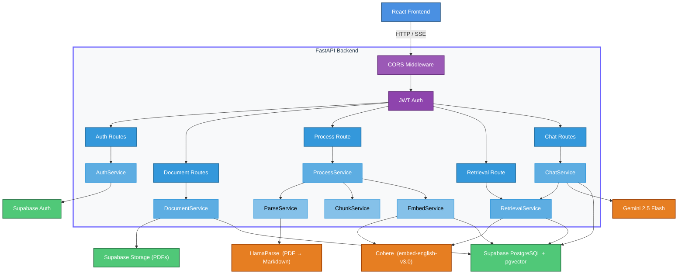
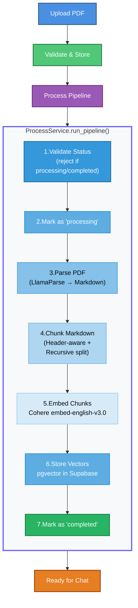
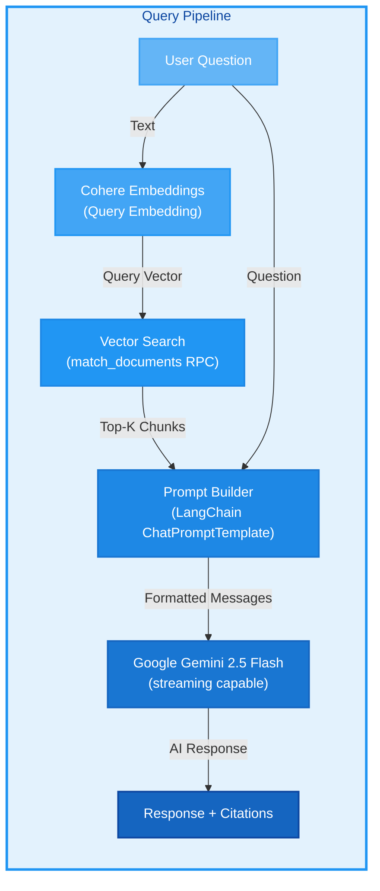
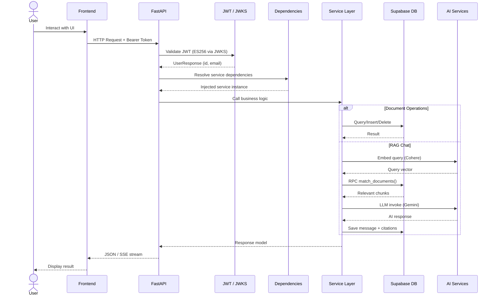
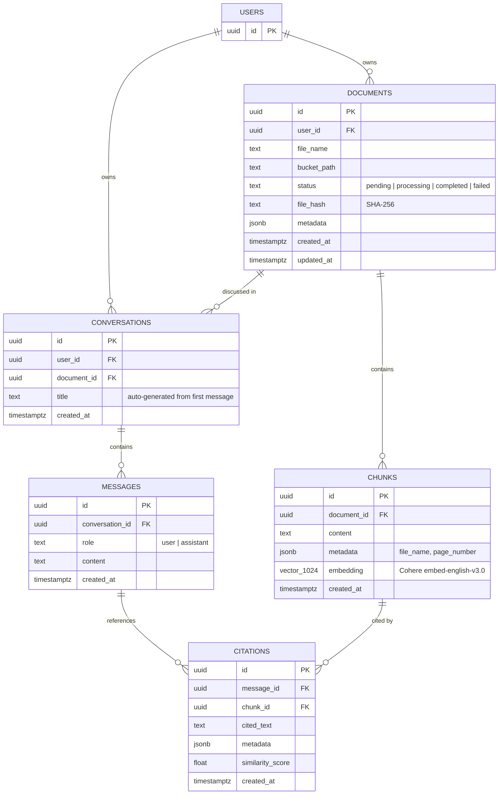
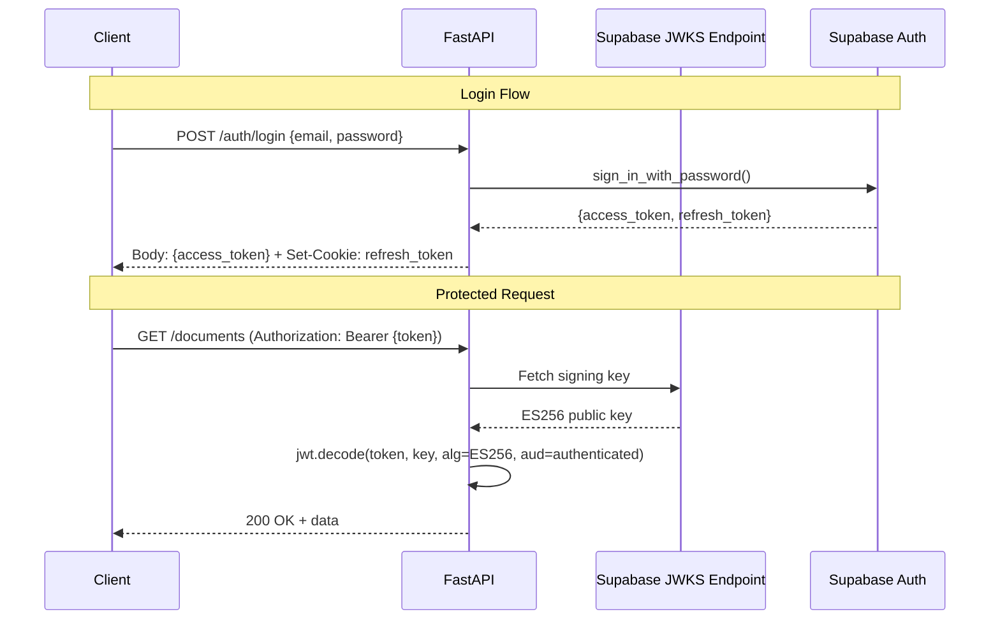

<p align="center">
  <h1 align="center">PDF RAG QA System</h1>
  <p align="center">
    <em>Full-stack Retrieval-Augmented Generation system for intelligent question answering over PDF documents</em>
  </p>
  <p align="center">
    
    
    
    
    
    
    
    
    
    
    

  </p>
</p>


## Table of Contents

- [Overview](#overview)
- [System Architecture](#system-architecture)
- [Tech Stack](#tech-stack)
- [Project Structure](#project-structure)
- [RAG Pipeline Workflow](#rag-pipeline-workflow)
- [API Request Lifecycle](#api-request-lifecycle)
- [Database Schema](#database-schema)
- [API Reference](#api-reference)
  - [Authentication](#authentication-endpoints)
  - [Documents](#document-endpoints)
  - [Processing & Semantic Search Endpoints](#processing--semantic-search-endpoints)
  - [Conversations & Chat](#conversation--chat-endpoints)
- [AI / LLM Integrations](#ai--llm-integrations)
- [Security & Middleware](#security--middleware)
- [Environment Configuration](#environment-configuration)
- [Getting Started](#getting-started)


## Overview

A  **PDF-based Retrieval-Augmented Generation (RAG)** system that allows users to:

1. **Upload** PDF documents to cloud storage  
2. **Process** them through an automated ingestion pipeline (parse → chunk → embed → store)  
3. **Chat** with their documents using an AI assistant grounded in the document's content  
4. **Receive cited answers** with source references and similarity scores  

The **backend** (FastAPI) leverages **LlamaParse** for PDF parsing, **Cohere** for semantic embeddings, **Google Gemini 2.5 Flash** for conversational AI, and **Supabase** (PostgreSQL + pgvector) as the unified backend for authentication, storage, and vector search.

The **frontend** (React 19 + Vite) provides a modern SPA with drag-and-drop PDF upload, real-time SSE streaming chat, rich Markdown rendering (GFM, LaTeX, syntax highlighting), and animated UI powered by Framer Motion.


## System Architecture




## Tech Stack

### Backend

| Layer | Technology | Purpose |
|---|---|---|
| **Framework** | FastAPI 0.119 | Async REST API with auto-generated OpenAPI docs |
| **Language** | Python 3.13+ | Runtime |
| **Validation** | Pydantic v2 | Request/response schemas with field validation |
| **Settings** | Pydantic Settings | Environment-based configuration (`.env`) |
| **Database** | Supabase (PostgreSQL) | Relational data, RLS-secured tables |
| **Vector Store** | pgvector (via Supabase) | 1024-dim embeddings with HNSW cosine index |
| **File Storage** | Supabase Storage | PDF bucket with per-user folder isolation |
| **Auth** | Supabase Auth + JWT (ES256) | User sign-up/login, JWKS-based token verification |
| **PDF Parsing** | LlamaParse  | Parse PDFs into Markdown,JSON,Text for use in LLM and RAG pipelines |
| **Embeddings** | Cohere `embed-english-v3.0` | 1024-dimensional semantic embeddings |
| **LLM** | Google Gemini 2.5 Flash | Conversational RAG with streaming support |
| **Orchestration** | LangChain 0.3 | Prompt templates, text splitters, model abstraction |
| **HTTP Server** | Uvicorn | ASGI server |
| **Package Manager** | uv | Fast Python package management |

### Frontend

| Layer | Technology | Purpose |
|---|---|---|
| **UI Framework** | React 19 | Component-based SPA |
| **Build Tool** | Vite 7 | Fast dev server with HMR |
| **Routing** | React Router v7 | Client-side routing with auth guards |
| **HTTP Client** | Axios | API calls with auto-refresh interceptor |
| **Streaming** | Fetch + ReadableStream | SSE-based real-time chat |
| **Animations** | Framer Motion | Page transitions and micro-interactions |
| **Markdown** | react-markdown + rehype-katex + remark-gfm | Rich AI response rendering |
| **Styling** | Vanilla CSS | Custom properties-based design system |


## Project Structure

```
pdf_RAG_App/
│
├── backend/
│   ├── .env.example              # Environment variable template
│   ├── pyproject.toml             # Project dependencies & metadata
│   ├── requirements.txt           # Pip-compatible dependency list
│   └── src/
│       ├── main.py                # FastAPI app entry point, CORS, health check
│       ├── core/
│       │   ├── config.py          # Pydantic Settings (env vars, app config)
│       │   └── clients.py         # Singleton factories (Supabase, LlamaParse, Cohere, Gemini)
│       ├── api/
│       │   ├── dependencies.py    # DI container: JWT auth, service factories
│       │   └── v1/
│       │       ├── router.py      # Central API router (wires all endpoints)
│       │       └── endpoints/     # auth, document, parse, chunk, embed, process, retrieve, chat
│       ├── schemas/               # Pydantic request/response models
│       ├── services/              # Business logic (auth, document, parse, chunk, embed, process, retrieval, chat)
│       ├── sql/
│       │   └── db.sql             # Full DB schema, RLS policies, vector search function
│       └── utils/
│           └── file_utils.py      # File validation, SHA-256 hashing
│
└── frontend/
    ├── .env                       # VITE_API_BASE_URL
    ├── package.json               # Dependencies & scripts
    ├── vite.config.js             # Vite config with dev proxy to backend
    └── src/
        ├── main.jsx               # App bootstrap (Router, AuthProvider, Toaster)
        ├── App.jsx                # Route definitions + auth guards
        ├── index.css              # Global styles & design tokens
        ├── api/                   # Axios client, auth, documents, conversations, SSE stream
        ├── context/               # AuthContext (user state, login, logout, auto-refresh)
        ├── hooks/                 # useChat, useConversations, useDocuments, useProcessing
        ├── pages/                 # LoginPage, SignupPage, DashboardPage
        ├── components/            # auth, chat, documents, layout, ui
        └── utils/                 # Date helpers, error extraction
```


## RAG Pipeline Workflow

### Ingestion Pipeline


### Query Pipeline



## API Request Lifecycle




## Database Schema

The database uses **5 core tables** with Row Level Security (RLS) enforced on all tables:



### Key Database Features

- **`pgvector` extension** — Enables native vector storage and similarity search  
- **HNSW index** — Approximate nearest-neighbor index on `chunks.embedding` using cosine distance  
- **`match_documents()` RPC** — Server-side function for cosine-similarity search scoped to a specific document and user  
- **Row Level Security** — Every table has RLS policies ensuring users can only access their own data  
- **Storage Policies** — PDF bucket uses folder-based isolation (`{user_id}/...`)  
- **Cascade Deletes** — Deleting a document cascades to chunks, conversations, messages, and citations  
- **Auto-updated timestamps** — Trigger on `documents` updates `updated_at` automatically  

## API Reference

All endpoints are prefixed with `/api/v1`. Interactive docs are available at `/docs` (Swagger) and `/redoc` (ReDoc).

### Health & Root

| Method | Endpoint  | Description |
|---|---|---|
| `GET` | `/`  | Root endpoint — returns welcome message and links |
| `GET` | `/health`  | Health check — returns service status and version |


### Authentication Endpoints

**Prefix:** `/api/v1/auth`

| Method | Endpoint  | Description |
|---|---|---|
| `POST` | `/signup`  | Register a new user (email + strong password) |
| `POST` | `/login`  | Authenticate, returns JWT access token + refresh cookie |
| `POST` | `/refresh`  | Exchange refresh cookie for a new access token |
| `GET` | `/me`  | Get current user profile |
| `POST` | `/logout`  | Clear refresh token cookie |


### Document Endpoints

**Prefix:** `/api/v1/documents`

| Method | Endpoint  | Description |
|---|---|---|
| `POST` | `/upload`  | Upload a PDF (max 5 MB, hash-based duplicate detection) |
| `GET` | `/`  | List documents (filterable by status, paginated) |
| `GET` | `/{document_id}`  | Get document metadata |
| `GET` | `/{document_id}/status`  | Poll processing status (lightweight) |
| `GET` | `/{document_id}/download`  | Generate a pre-signed download URL (configurable expiry) |
| `DELETE` | `/{document_id}`  | Delete document + storage file (cascades to all related data) |


### Processing & Semantic Search Endpoints

**Prefix:** `/api/v1/documents`

| Method | Endpoint  | Description |
|---|---|---|
| `POST` | `/{document_id}/process` |  Run the full **parse → chunk → embed** pipeline |
| `POST` | `/{document_id}/parse` |  Parse PDF via LlamaParse (individual step) |
| `POST` | `/chunk` |  Split markdown into semantic chunks (individual step) |
| `POST` | `/{document_id}/embed` |  Embed chunks & store vectors (individual step) |
| `POST` | `/{document_id}/retrieve` |  Run semantic vector search over embedded chunks |


### Conversation & Chat Endpoints

**Prefix:** `/api/v1/conversations`

| Method | Endpoint |  Description |
|---|---|---|
| `POST` | `/`  | Create a new conversation for a processed document |
| `GET` | `/`  | List all user conversations |
| `GET` | `/{conversation_id}/history`  | Get full message history with citations |
| `POST` | `/{conversation_id}/chat`  | Send a message, get a grounded AI response |
| `POST` | `/{conversation_id}/chat/stream`  | Same as chat, but **streamed via SSE** |
| `DELETE` | `/{conversation_id}`  | Delete conversation and all messages |


## AI / LLM Integrations


| Service | Provider | Model / Config | Purpose |
|---|---|---|---|
| **PDF Parsing** | LlamaParse  | Tiers: `fast`, `cost_effective`, `agentic`, `agentic_plus` | Converts PDF to structured Markdown or Text |
| **Embeddings** | Cohere | `embed-english-v3.0` (1024 dims) | Generates semantic vectors for chunks and queries |
| **Chat LLM** | Google Gemini | `gemini-2.5-flash` (temp=0.2, streaming) | Generates grounded answers with citations |
| **Prompt Engineering** | LangChain | `ChatPromptTemplate` + `MessagesPlaceholder` | RAG prompt with context, history, and formatting instructions |


## Security & Middleware

### Authentication Flow



### Security Layers

| Layer | Implementation | Details |
|---|---|---|
| **JWT Validation** | PyJWT + JWKS (ES256) | Tokens verified against Supabase's JWKS endpoint with audience/issuer checks |
| **CORS** | `CORSMiddleware` | Origins restricted to `BACKEND_CORS_ORIGIN`, credentials enabled |
| **Row Level Security** | PostgreSQL RLS policies | Every table enforces `auth.uid() = user_id` — users can only access their own data |
| **Storage Isolation** | Folder-based bucket policies | Files stored under `{user_id}/` path, policies enforce folder ownership |
| **Password Validation** | Pydantic `field_validator` | Enforces complexity requirements (uppercase, lowercase, digit, special) |
| **File Validation** | `validate_file()` utility | MIME type check, extension check, size limit (5 MB), empty file rejection |
| **Duplicate Detection** | SHA-256 hash check | Prevents re-uploading identical PDFs |
| **Refresh Token Security** | HttpOnly, Secure, SameSite=None cookie | 7-day TTL, scoped to `/api/v1/auth/refresh`, rotated on each use |


## Environment Configuration

### Backend (`backend/.env`)

```env
# ──── AI Service Keys ────
GOOGLE_API_KEY=your_google_api_key           # Google Gemini API key
COHERE_API_KEY=your_cohere_api_key           # Cohere embeddings API key
LLAMA_CLOUD_API_KEY=your_llama_cloud_api_key # LlamaParse API key

# ──── Supabase ────
SUPABASE_URL=https://your-project-id.supabase.co
SUPABASE_KEY=your_supabase_service_role_key

# ──── CORS ────
BACKEND_CORS_ORIGIN=http://localhost:3000    # Frontend URL
```

### Frontend (`frontend/.env`)

```env
VITE_API_BASE_URL=http://localhost:8000/api/v1
```

### Application Defaults (configured in `config.py`)

| Setting | Default | Description |
|---|---|---|
| `APP_NAME` | `PDF RAG QA System` | Application display name |
| `APP_VERSION` | `1.0.0` | Current version |
| `API_V1_PREFIX` | `/api/v1` | API route prefix |
| `ALGORITHM` | `ES256` | JWT signing algorithm |
| `MAX_FILE_SIZE_MB` | `5` | Maximum upload size |
| `ALLOWED_MIME_TYPES` | `["application/pdf"]` | Accepted file types |
| `STORAGE_BUCKET_NAME` | `pdfs` | Supabase storage bucket name |


## Getting Started

### Prerequisites

- **Python 3.13+** and **uv** (or pip)
- **Node.js 18+** and npm
- A **Supabase** project with:
  - Auth enabled
  - Storage bucket named `pdfs` created
  - Database schema applied (run `backend/src/sql/db.sql` in the SQL Editor)
- API keys for **Google AI**, **Cohere**, and **Llama Cloud**

### Database Setup

Run the SQL schema in your Supabase SQL Editor to create all tables, indexes, RLS policies, and the `match_documents` function:

```bash
# Copy the contents of backend/src/sql/db.sql and run in Supabase SQL Editor
```

### Backend

```bash
cd backend

# Install dependencies with uv (recommended)
uv sync

# Or with pip
pip install -r requirements.txt

# Start the server (port 8000)
uvicorn src.main:app --reload --host 0.0.0.0 --port 8000
```

API docs available at:
- **Swagger UI for Interactive Testing**: [http://localhost:8000/docs](http://localhost:8000/docs)
- **ReDoc for Reading and Reference**: [http://localhost:8000/redoc](http://localhost:8000/redoc)

### Frontend

```bash
cd frontend

# Install dependencies
npm install

# Start dev server (port 3000)
npm run dev
```

The app will be available at **http://localhost:3000**.