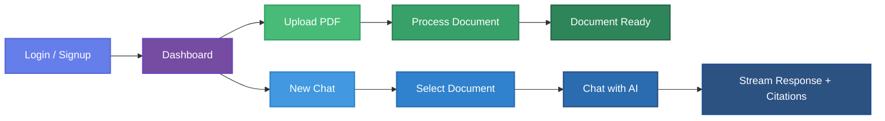

<p align="center">
  <h1 align="center">PDF RAG Chat — Frontend</h1>
  <p align="center">
    <em>A modern React SPA for uploading PDFs, managing documents, and chatting with an AI assistant</em>
  </p>
</p>


## Overview

Single-page application that serves as the frontend for the **PDF RAG QA System**. Users can sign up, upload PDF documents, trigger the RAG ingestion pipeline, and have **real-time streamed conversations** with an AI assistant grounded in their documents.


## Tech Stack

| Category | Technology |
|---|---|
| **UI Framework** | React 19 |
| **Build Tool** | Vite 7 |
| **Routing** | React Router v7 |
| **HTTP Client** | Axios (with auto-refresh interceptor) |
| **Streaming** | Fetch + ReadableStream (SSE) |
| **Animations** | Framer Motion |
| **Markdown** | react-markdown + remark-gfm + rehype-katex |
| **File Upload** | react-dropzone |
| **Notifications** | react-hot-toast |
| **Icons** | react-icons (Feather + Heroicons) |
| **Styling** | Vanilla CSS with CSS custom properties |
| **Font** | Inter (Google Fonts) |


## Project Structure

```
frontend/
├── index.html                  # Entry HTML (Inter font + KaTeX CSS)
├── vite.config.js              # Vite config with dev proxy to backend
├── .env                        # VITE_API_BASE_URL
│
└── src/
    ├── main.jsx                # App bootstrap (Router, AuthProvider, Toaster)
    ├── App.jsx                 # Route definitions + auth guards
    ├── index.css               # Global styles & design tokens
    │
    ├── api/                    # API client layer
    │   ├── axios.js            # Axios instance + token refresh interceptor
    │   ├── auth.js             # Auth endpoints (signup, login, refresh, me, logout)
    │   ├── documents.js        # Document endpoints (upload, list, process, delete)
    │   ├── conversations.js    # Conversation endpoints (create, list, history, delete)
    │   └── stream.js           # SSE streaming client via fetch + ReadableStream
    │
    ├── context/
    │   └── AuthContext.jsx     # Auth state (user, login, signup, logout, auto-refresh)
    │
    ├── hooks/
    │   ├── useChat.js          # Chat messages, SSE streaming, citations
    │   ├── useConversations.js # Conversation CRUD + list management
    │   ├── useDocuments.js     # Document upload, process, delete, filter
    │   └── useProcessing.js    # Status polling (3s interval)
    │
    ├── pages/
    │   ├── LoginPage.jsx       # Login form
    │   ├── SignupPage.jsx      # Signup form
    │   └── DashboardPage.jsx   # Main app (documents + chat views)
    │
    ├── components/
    │   ├── auth/
    │   │   └── AuthForm.jsx    # Shared login/signup form
    │   ├── chat/
    │   │   ├── ChatView.jsx    # Chat container
    │   │   ├── ChatInput.jsx   # Message input with send/stop controls
    │   │   ├── MessageBubble.jsx # User/assistant message display
    │   │   ├── MarkdownRenderer.jsx # Markdown with GFM, KaTeX, syntax highlighting
    │   │   ├── Citations.jsx   # Source citations with similarity scores
    │   │   └── TypingIndicator.jsx # Streaming animation
    │   ├── documents/
    │   │   ├── UploadZone.jsx  # Drag & drop PDF upload
    │   │   ├── DocumentList.jsx # Filtered document grid
    │   │   ├── DocumentCard.jsx # Individual document card with actions
    │   │   └── StatusBadge.jsx # Status indicator (pending/processing/completed/failed)
    │   ├── layout/
    │   │   └── Sidebar.jsx     # Conversation list + new chat + user menu
    │   └── ui/
    │       ├── EmptyState.jsx  # Empty placeholder component
    │       └── ConfirmDialog.jsx # Confirmation modal
    │
    └── utils/
        └── helpers.js          # Date formatting, error extraction, truncation
```


## Key Features

- **JWT Authentication** — login/signup with automatic token refresh via HttpOnly cookies
- **Protected Routing** — guest and authenticated route guards
- **Drag & Drop Upload** — PDF upload with progress tracking
- **Pipeline Status Polling** — real-time document processing status 
- **Real-time Streaming Chat** — SSE-based token-by-token AI responses
- **Rich Markdown Rendering** — GFM tables, LaTeX math, syntax highlighting, raw HTML
- **Citations** — source references with similarity scores displayed per message
- **Conversation Management** — create, list, switch, delete conversations via sidebar
- **Smooth Animations** — page transitions & modals powered by Framer Motion
- **Toast Notifications** — success/error feedback across all actions


## Application Flow




## Environment Variables

Create a `.env` file in the `frontend/` directory:

```env
VITE_API_BASE_URL=http://localhost:8000/api/v1
```

> In development mode, Vite proxies `/api` requests to `http://localhost:8000` automatically.


## Getting Started

```bash
# Install dependencies
npm install

# Start dev server (port 3000)
npm run dev

# Build for production
npm run build

# Preview production build
npm run preview
```

The app will be available at **http://localhost:3000**.

> Make sure the backend server is running on port 8000 before starting the frontend.


